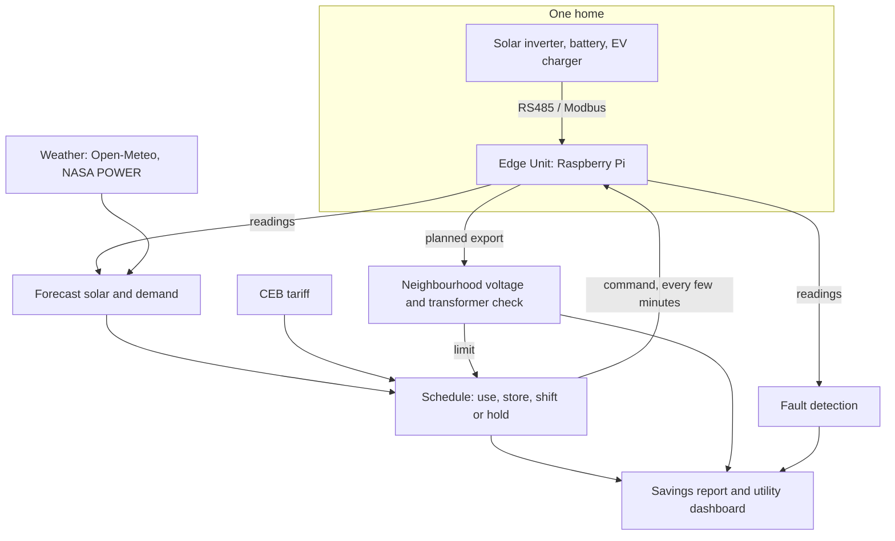

# Rooftops to Power Plant

AI that makes Sri Lanka's home solar work for the grid.

This repository is the codebase for that project. Team Blitzkrieg, Curtin University Colombo, is entering it in the AIconomy International AI Challenge 2026/27. A low-cost edge unit and a scheduler cut household bills, ease transformer overloads, and let many homes act together as one power plant the utility can see.

## The problem

Sri Lanka has 2,542 MW of rooftop solar, close to the national peak demand of about 2,600 MW. The grid cannot see that solar, or tell it what to do. The February 2025 island-wide blackout followed a period when solar supplied over half of demand. At midday, neighbourhood transformers overload and new solar connections are refused. In the evening the country burns imported oil and coal.

The tariff makes this worse for the household. A unit here is a kilowatt-hour. Homeowners earn only LKR 15.81–23.11 for a unit they export, and pay up to about LKR 100 for a unit they buy back later.

About 129,000 households already have rooftop solar. The project is for them, for EV owners, and for the utilities: the Ceylon Electricity Board (CEB) and the Lanka Electricity Company (LECO). If the same idea reached 200,000 homes, the team estimates about 365 GWh a year would move from oil-fired evening generation onto stored solar, worth about USD 65–75 million a year kept in Sri Lanka. Those two national figures are the team's own estimates. The other figures in this README come from the one-page proposal in `docs/proposal.pdf`.

## The solution

A small Edge Unit sits in the home. It is a Raspberry Pi connected to the solar inverter, the battery and the EV charger by RS485/Modbus, the wired link most inverters already speak. The same software works with any inverter brand. Today's inverters follow a fixed setting all day. This system chooses again every few minutes, using the time of day, the tariff and a limit from the local grid.

For each unit of solar power it picks one action:

- use it in the house now
- store it in the battery for the evening peak (6:30–10:30 pm)
- shift EV charging or water heating into the sunny hours
- hold the export back so the neighbourhood transformer is not pushed over its limit

The household gets a daily schedule and a savings report, compared with what the inverter would have done on its default settings. Many Edge Units together are one virtual power plant, and the utility watches them on a single dashboard.

Inputs are inverter readings, weather and tariffs. Weather comes from Open-Meteo and NASA POWER. Tariffs are the published CEB rates. Inverter logs come from the pilot home and are not stored in git. See Getting started.

## How AI is used

Three jobs, all in Python:

1. Forecast solar output and household demand from the weather and from measurements at the house. The first models will be LightGBM, a tree-based model that works well on this kind of table data.
2. Predict how each home's exports raise the voltage in the neighbourhood, using pandapower (a Python library for electrical network studies), so transformer capacity is shared fairly rather than taken by whichever house exports first.
3. Detect faults and unsafe inverter settings from readings the Edge Unit is already collecting.

The proposal sets three checks on whether this is working: the fall in the household bill compared with default inverter settings; transformer overload hours avoided in a 50-home simulation; and the forecast error.

## Architecture



Each house has one Edge Unit. The forecast and the grid check feed the scheduler, and the scheduler sends a command back to the house. The same results, plus any fault alert, appear on the dashboard. Run that loop across many houses and the dashboard is the virtual power plant the utility sees.

## Repository layout

| Path | What it is for | Owner |
| --- | --- | --- |
| `edge-unit/` | Raspberry Pi software that talks to the inverter, battery and EV charger | Tatiana Armstrong, Mithil Rajapakse |
| `forecasting/` | Solar and household demand forecasts | Senesh Fernando |
| `scheduler/` | The use / store / shift / hold decision, the daily schedule and the savings report | Senesh Fernando |
| `grid-sim/` | pandapower model of a neighbourhood | Mithil Rajapakse |
| `fault-detect/` | Faults and unsafe inverter settings | Mithil Rajapakse |
| `dashboard/` | Household page and utility page | Senesh Fernando |
| `data/` | Weather downloads, simulated PV tables, and small samples. See `data/README.md` | Senesh Fernando |
| `docs/` | The proposal, and later write-ups | Mithil Rajapakse |

Each folder has a short README with the planned contents. Weather downloads and the simulated PV tables are tracked under `data/raw/weather/`, `data/raw/live/` and `data/processed/pv_simulated/`. Anything else dropped in `data/raw/` or `data/processed/` is gitignored, so a pilot inverter log is not committed by mistake. `data/sample/` is a small extract of the same tables.

## Team

Team Blitzkrieg, Curtin University Colombo, Sri Lanka. Mentor: Dr Umanga Pilapitiya.

- Mithil Rajapakse, electrical engineering, team lead
- Tatiana Armstrong, mechatronics
- Senesh Fernando, software

The team already has a pilot home and a contact at the utility. Phone numbers and email addresses are not kept in this repository.

## Roadmap

Taken from the proposal. Status today: idea / concept.

1. November. Research and data preparation. Interviews with the utility and with solar installers. Inverter data from the pilot home. Weather and tariff data gathered.
2. December to January. Build and testing. The Edge Unit reading the pilot inverter. Forecasting and scheduling models. A 50-home neighbourhood simulation. Concept paper submitted by 31 December.
3. February. Pilot and demonstration. Two to five homes in Colombo and Gampaha. A tabletop low-voltage grid showing the software stopping an overload and a blackout. A live utility dashboard.

## Getting started

Python 3.11 or newer.

```bash
python3 -m venv .venv
source .venv/bin/activate
pip install -r requirements.txt
```

On Windows, activate with `.venv\Scripts\activate`.

Weather download and the simulated rooftop PV series are in `data/`. See `data/README.md` for the commands. Solar and household demand forecasts are in `forecasting/` (`--target pv` or `--target demand`). The hosted API, database and scheduled jobs are in `DEPLOY.md`. They stay on free tiers. The Pi code and the dashboard are not written yet. `requirements.txt` is a shared starting set: pandas, NumPy, LightGBM, pandapower, Requests, PyModbus, scikit-learn, Matplotlib, Jupyter, Streamlit, pvlib and pytest.

Put pilot inverter logs in `data/raw/`, not inside `weather/` or `live/`. Git ignores loose files there. The weather files and the simulated PV tables are already in the repo.

Branch names and reviews are in `CONTRIBUTING.md`.

## GitHub Pages

A static read-only PV forecast dashboard is published from the `docs/` folder:

**https://team-blitzkrieg.github.io/rooftop-vpp/**

It mirrors the Streamlit tabs (overview, forecast day, model report) using committed JSON under `docs/data/`. Data are **SIMULATED**; issue time is midnight **Asia/Colombo**. The page does not send commands to inverters.

To refresh artefacts locally from the repo root:

```bash
python scripts/export_github_pages.py --with-demo-train
```

The org must enable Pages for this repository: **Settings → Pages → Build and deployment → Source: GitHub Actions**. Pushes to `main` and manual workflow runs rebuild the site via `.github/workflows/github-pages.yml`.

## Deploy on Vercel

The same static dashboard under `docs/` can be deployed on [Vercel](https://vercel.com) without running Python in the cloud build. Production uses the committed `docs/data/` JSON (same as a zero-build GitHub Pages export). Vercel works with a **private** GitHub repo on the Hobby plan.

1. Import **team-blitzkrieg/rooftop-vpp** in the Vercel dashboard (New Project → connect GitHub).
2. Leave **Root Directory** as `.` (repository root).
3. Framework preset: **Other** (no framework). Vercel reads `vercel.json` at the repo root: `outputDirectory` is `docs`, and install/build commands are empty.
4. Deploy. The live URL is `https://<project-name>.vercel.app` (preview URLs on other branches use the same pattern).

To refresh demo forecast data before a deploy:

```bash
python scripts/export_github_pages.py --with-demo-train
git add docs/data
git commit -m "Refresh static dashboard data"
git push
```

Optional (advanced): if the team later wants Vercel to regenerate `docs/data` on every push, set **Build Command** in the Vercel project settings (or in `vercel.json`) to `python scripts/export_github_pages.py --with-demo-train` and **Install Command** to `pip install -r requirements.txt`, with Python 3.12. LightGBM and large training deps can be slow or fragile on Vercel builders; the recommended path is local export + commit, as for GitHub Pages.
