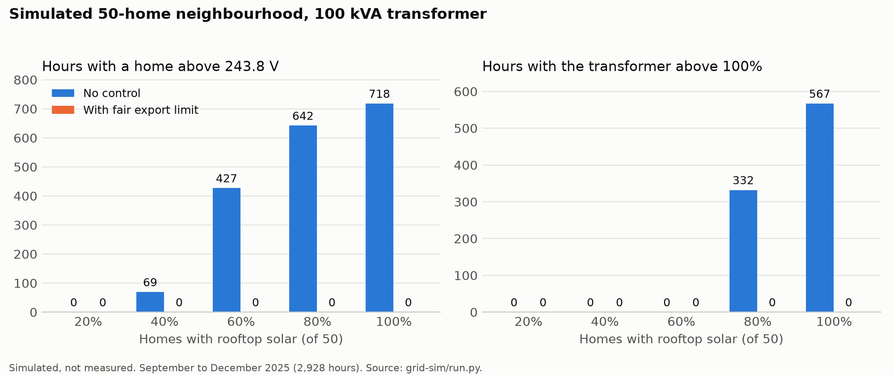

# Grid simulation

Owner: Mithil Rajapakse (electrical engineering).

## Purpose

Estimate how each home's exports change the voltage on the neighbourhood line, and whether the transformer is heading for an overload. Then show what a fair export limit does about it. This is the "50-home simulation" success measure from the proposal (pipeline tasks B1 and B3, and the demand profile S4).

**Everything here is simulated.** The neighbourhood, the solar output and the household demand are models. No real feeder was studied.

## What is here

| File | What it is |
|---|---|
| `gridsim/feeder.py` | The pandapower model: one transformer, two lines, 50 homes |
| `gridsim/demand.py` | Simulated household demand, with the assumptions listed in the file |
| `gridsim/simulate.py` | The year run, the learned voltage model and the export-limit controller |
| `run.py` | Runs every case and writes `results/` |
| `demand_profile_simulated.csv` | The average-day demand shape (task S4), with a metadata file |
| `results/summary.csv` | One row per solar share, case and period |
| `results/voltage_model_test.csv` | Error of the learned voltage model on unseen months |
| `results/hourly_share_60.csv` | Hour-by-hour values for the main case |
| `results/control_result.png` | The chart for the paper |
| `results/meta.json` | Every assumption, and which homes had solar |
| `../tests/test_grid_sim.py` | 5 unit tests |

Run (about 10 minutes on a laptop, 6 processes):

```bash
python grid-sim/run.py
```

Smoke test (about 1 minute, writes to `results_quick/`):

```bash
python grid-sim/run.py --quick
```

## The model in plain words

- One 100 kVA, 11/0.4 kV transformer feeds two overhead lines.
- Each line has 13 poles, 40 m apart (520 m), with 25 homes along it.
- A share of the 50 homes has solar: 3, 5 or 10 kW (30%, 50%, 20% of solar homes).
- Solar output comes from the repo's simulated Colombo table for 2025 (`data/processed/pv_simulated/open_meteo_archive/`).
- Demand is simulated: 10 kWh a day for a home with solar, 4 kWh a day for a home without, an evening peak at 19:00-20:00, and 5 homes with a 3.7 kW EV charger used in the evening.
- Limits checked each hour: home voltage 230 V +/-6% (216.2 to 243.8 V), and transformer loading 100%.

## The control tested

1. **Learn.** From January to August, fit a straight-line model: each home's voltage, and the transformer flow, as a function of every home's net power. It uses only what a fleet of Edge Units could measure. No network map is needed.
2. **Limit.** From September to December (months the model has not seen), each hour the controller picks one export limit, the same share of system size for every solar home, so that the predicted voltage stays under 241.5 V (1.05) and the transformer under 95%. Every home is held back by the same share. No home is cut off because it is at the end of the line.
3. **Store.** In the third case, 30% of solar homes have a 5 kWh battery. It stores the held-back energy and releases it from 18:00 to 22:00.
4. **Check.** The real power flow is run again with the limit applied.

## Results

Test months only: September to December 2025, 2,928 hours.

| Homes with solar | Over-voltage hours, no control | With limit | Transformer overload hours, no control | With limit | Solar held back by the limit | Held back with batteries |
|---|---|---|---|---|---|---|
| 20% (10 homes, 47 kW) | 0 | 0 | 0 | 0 | 0% | 0% |
| 40% (20 homes) | 69 | 0 | 0 | 0 | 7.6% | 5.2% |
| **60% (30 homes, 155 kW)** | **427** | **0** | 0 | 0 | **19.0%** | **14.0%** |
| 80% (40 homes) | 642 | 0 | 332 | 0 | 31.0% | 25.2% |
| 100% (50 homes) | 718 | 0 | 567 | 0 | 37.5% | 31.5% |

Full year 2025 with no control: 266 over-voltage hours at 40%, 1,294 at 60%, 1,999 at 80%. The transformer first overloads between 60% and 80% (1,023 overload hours at 80%).

Learned voltage model, tested on the unseen months: average error 0.04 V at the 60% share (worst single error 0.27 V). At 100% it is 0.12 V (worst 0.70 V).



## What the results say, and what they do not

1. **Voltage is the first limit, not the transformer.** High voltage appears at 40% of homes. The transformer overloads only above 60%.
2. **The limit removes every over-voltage and overload hour in the test months.** It does this from measurements alone.
3. **The limit has a cost.** At 60% it holds back 19% of the solar energy in those months. Under Net Plus that is 19% of export income for every solar home. Batteries reduce the loss only a little (19% to 14%) with 9 batteries of 5 kWh.
4. **Without control the homes do not keep that energy anyway.** CEB settings switch an inverter off when the 10-minute voltage passes 243.8 V. The model does not include that switching off, so the "no control" case over-states what homes really export. A fair comparison needs it (next steps).
5. **One assumption decides most of the result.** With the source voltage at 1.00 instead of 1.02, over-voltage hours at 60% fall from 1,294 a year to 36, and the limit holds back 1.6% instead of 19%. The real tap setting of real transformers must come from the utility.
6. **Evening demand is not a problem in this neighbourhood.** The evening peak is about 53 kW on a 100 kVA transformer. Batteries cut it by about 3 kW.

## Limits

- Balanced three-phase model. Real homes are mostly single-phase, so real voltage is less even and problems start earlier.
- The feeder (transformer size, line length, conductor, homes per transformer, tap) is a set of assumptions, not a surveyed feeder.
- Demand is invented. Solar is a pvlib model, not meter data.
- The controller sees the true load and solar in the hour it acts. A real one would use a short forecast and would be slower.
- Limiting real power is the bluntest tool. Inverters can also lower voltage with reactive power (volt-var). That usually costs far less energy. It is not modelled.
- Hourly steps. Voltage moves faster than that.

## Next steps

1. Ask the utility for real feeder values (interview question 4 and the extra questions).
2. Add inverter switching off at 243.8 V to the no-control case, and count the energy lost that way.
3. Add volt-var control and compare its cost with the export limit.
4. Use the day-ahead forecast (`open_meteo_previous_day1`) in place of perfect knowledge.
5. Replace the stand-in controller with Senesh's scheduler (task B2) through one call: planned exports in, voltage and loading out (`VoltageModel.predict`).
6. Notes for the February tabletop grid: the rig should show voltage rise along a line, since that is the first limit.
